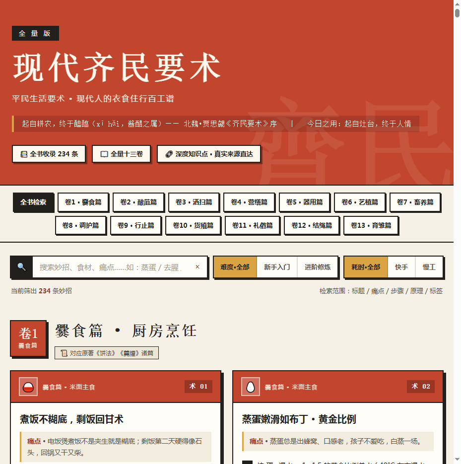

# 现代齐民要术

> 一部仿古体例的现代生活百科：十三卷、234 条实用技巧，装在一个纯离线的 HTML 文件里。

1400 年前，贾思勰写《齐民要术》，教当时的平民种地、做酱、酿酒、过日子。这部现代版把今天年轻人过日子要用到的 234 条实用技巧，仿照「卷—篇—术」的体例编成十三卷，每卷标注对应原著的篇目。



## 怎么用

整部「书」就是根目录的 **`index.html`** 一个文件：不用安装、不用联网、不用服务器，双击用浏览器打开即是全书。存进手机、传给家人、放进平板，随时随地翻。

- 顶部搜索框实时过滤全书，命中关键词高亮
- 难度（新手入门 / 进阶修炼）与耗时（快手 / 慢工）双重筛选
- 十三卷按钮在页首平铺，点哪卷看哪卷
- 每条技巧是一张完整的知识卡片：痛点场景 → 操作步骤 → 「格物」原理 → 难度耗时 → 来源直达

在线版本：<https://davin-96.github.io/modern-qimin-yaoshu/>

## 内容

十三卷依次为：爨食 · 酿菹 · 洒扫 · 营缮 · 器用 · 艺植 · 畜养 · 调护 · 行止 · 货殖 · 礼俗 · 结绳 · 育雏。

每条技巧都标注来源，复杂知识点挂直达链接；素材取自人民日报、新华网、科普中国、应急管理部消防救援局等权威信源，以及小红书、抖音、知乎等平台的实测反馈。育儿相关条目只采权威医源，流传较广的错误说法会在书中直接辟谣。

完整的项目故事见 [自媒体宣传文案](宣传文案/现代齐民要术-自媒体宣传文案.md)。

## 目录

```
index.html                           # 全书，纯离线单文件应用
宣传文案/
  现代齐民要术-自媒体宣传文案.md      # 项目介绍与编后话
  images/                            # 6 张界面截图
```
