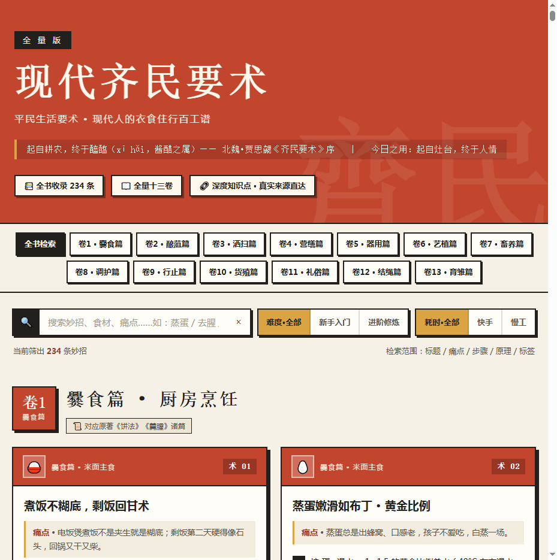
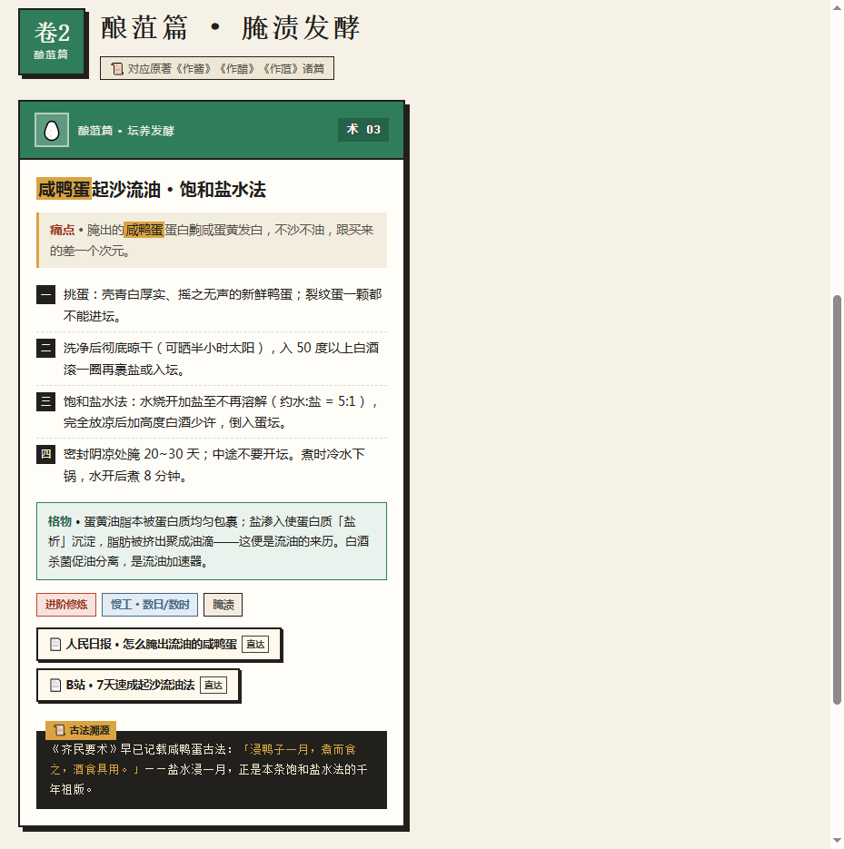
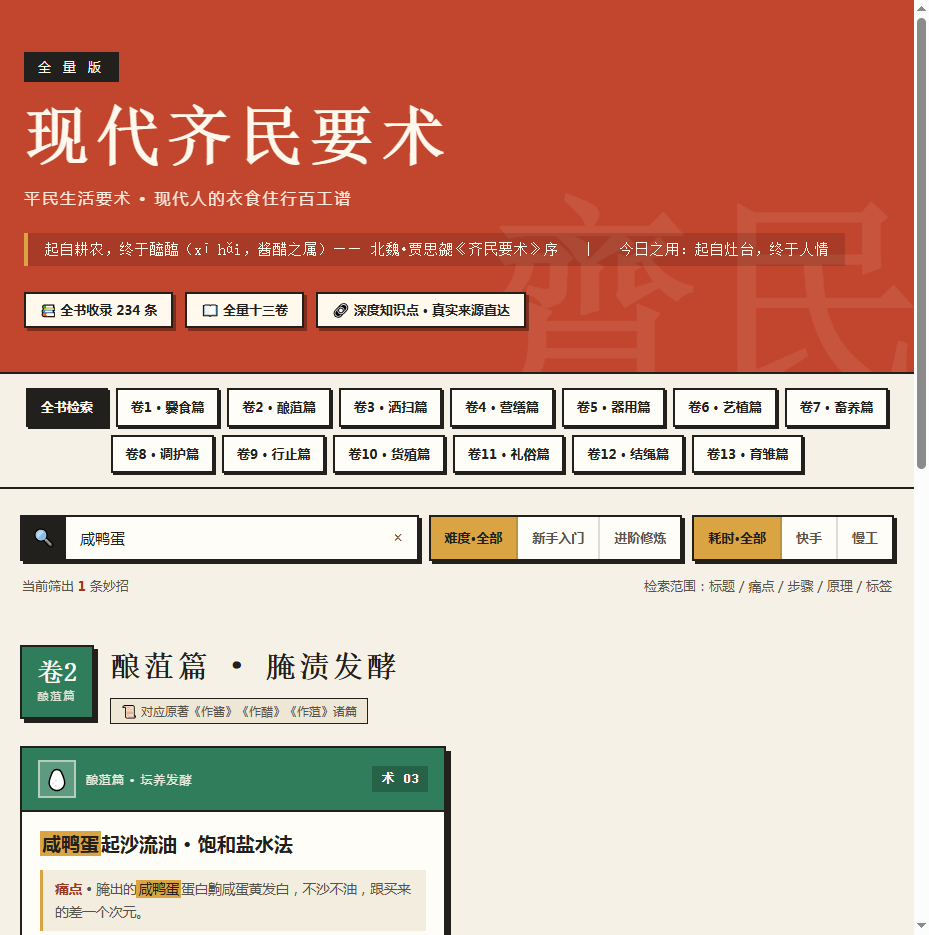
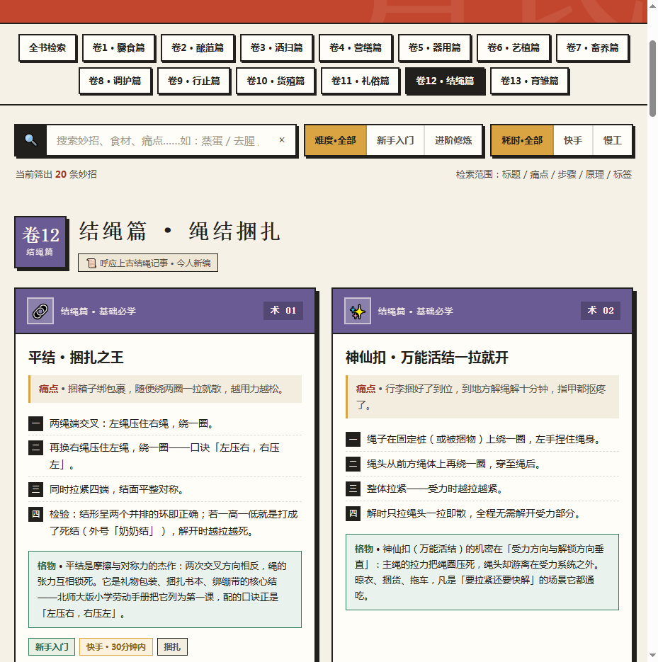
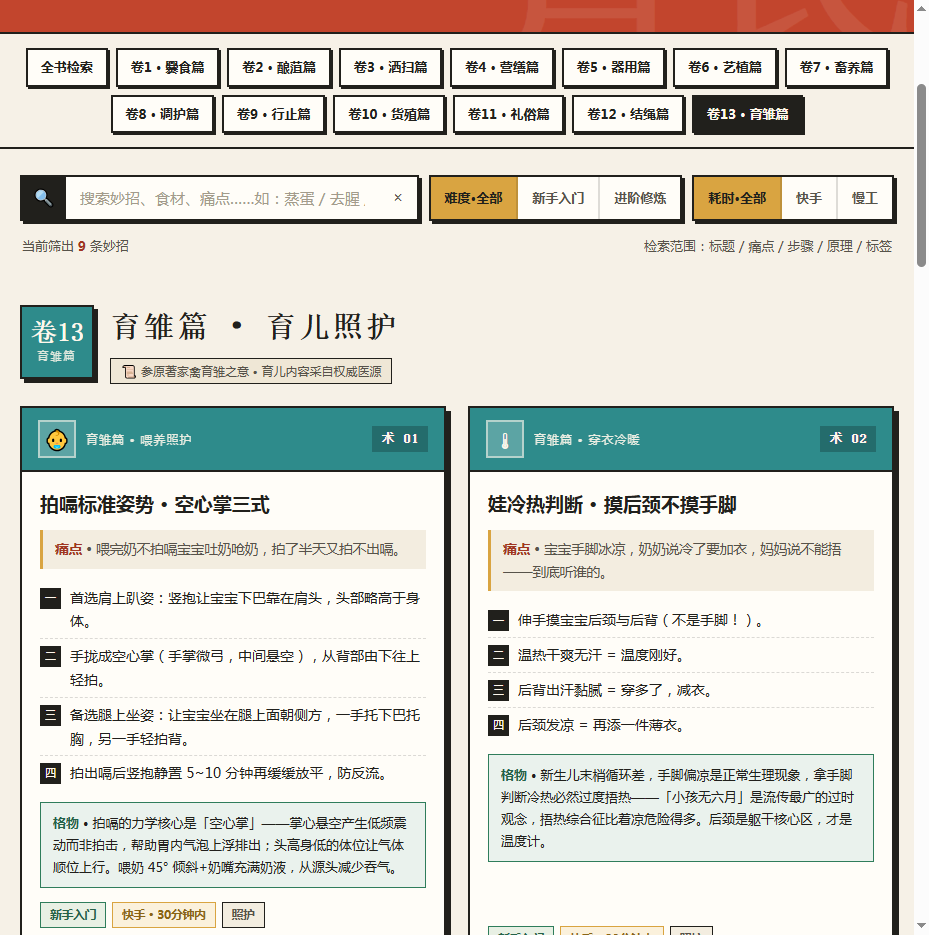
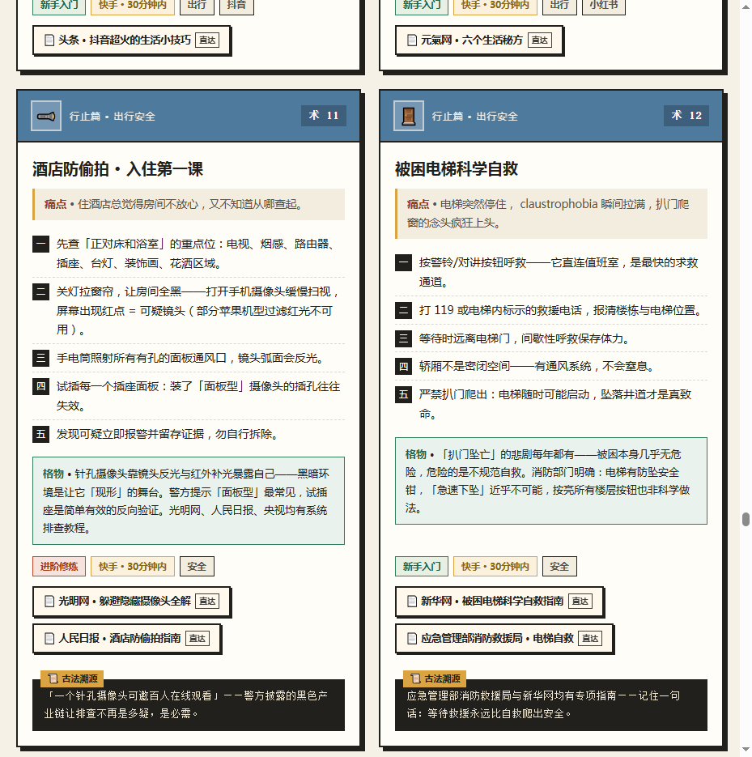

# 我把 234 条生活妙招，编成了一部《现代齐民要术》

> 1400 年前，北魏农学家贾思勰写了一本《齐民要术》，教当时的平民怎么种地、做酱、酿酒、过日子。
> 1400 年后，我干了一件 similar 的事——把今天年轻人过日子要用到的 234 条实用技巧，编成了一部**十三卷的现代齐民要术**。
> 它是一个纯离线的 HTML 文件，双击就能打开，免费使用，这篇文章讲讲它是怎么来的、是什么、怎么用。

## 一、它是怎么来的？

事情从一个朴素的问题开始：**为什么我们这一代人的"生活知识"，散落得这么厉害？**

- 小红书上博主说淘米水能洗碗，评论区有人反驳说会招虫；
- 抖音百万赞视频教"锡纸团擦不锈钢"，但也有人踩坑说完全没用；
- 公众号收藏夹里躺着 200 篇"生活妙招合集"，真要用的时候一条也搜不出来；
- 最气人的是，很多老一辈传下来的经验（比如"小孩无六月，要多穿"），其实是被现代医学明确辟谣的谣言。

**好技巧不是没有，是缺一个"可信、可查、可复用"的地方放它们。**

所以我做了三件事：

1. **广撒网**：翻遍了 B 站、人民日报客户端、新华网、小红书、抖音、什么值得买、下厨房、公众号文章——甚至专门去挖爆款视频**评论区**里那些"交作业返图"的实战反馈；
2. **严筛选**：每一条技巧都问三个问题——原理讲不讲得通？来源可不可查？评论区有没有人验证过？通不过的，再火也不收；通过了谣言（比如"白醋+小苏打混合清洁力翻倍"这条流传极广的错误说法），反手就在书里辟谣；
3. **成体系**：仿照《齐民要术》"卷—篇—术"的结构，把 234 条技巧编成十三卷，每卷还标注了它对应原著的哪一篇——比如"酿菹篇"对应原著的《作酱》《作醋》，"货殖篇"对应《货殖》。

## 二、它是什么？

一句话：**一部仿古体例的现代生活百科，长在一个 HTML 文件里。**

### 十三卷，234 条，覆盖你过日子的所有环节

| 卷 | 篇名 | 内容 |
|---|---|---|
| 一 | 爨食篇 | 厨房烹饪：煮饭、蒸蛋、切肉口诀、煎鱼不破皮 |
| 二 | 酿菹篇 | 腌渍发酵：泡菜起坛、咸鸭蛋流油、发面诀窍 |
| 三 | 洒扫篇 | 清洁收纳：家政女皇配方、邪修清洁、洗衣机自洁 |
| 四 | 营缮篇 | 居家修缮：水龙头漏水、门锁润滑、插座安全 |
| 五 | 器用篇 | 数码通讯：电池延寿、WiFi 摆位、手机进水急救 |
| 六 | 艺植篇 | 阳台园艺：葱蒜再生、多肉度夏、黄叶诊断 |
| 七 | 畜养篇 | 宠物饲养：猫剪甲避血线、鱼缸困水、骗猫喝水 |
| 八 | 调护篇 | 健康护理：烫伤五字诀、海姆立克、扭伤 RICE |
| 九 | 行止篇 | 出行居住：**酒店防偷拍**、被困电梯自救、搬家打包 |
| 十 | 货殖篇 | 省钱理财：峰谷电价、外卖红包组合拳、临期捡漏 |
| 十一 | 礼俗篇 | 节令人情：随份子行情、敬酒词公式、点菜心法 |
| 十二 | 结绳篇 | 绳结捆扎：平结、称人结、露营风绳、救援双八结 |
| 十三 | 育雏篇 | 育儿照护：拍嗝、哄睡、辅食补铁、安全座椅 |

### 每条妙招，都是一套完整的"知识卡片"

不是一句话鸡汤，而是五段式结构：**痛点场景 → 操作步骤 → "格物"原理 → 难度耗时标签 → 来源直达链接**。

最得意的设计是"格物"栏——每条技巧都讲清楚背后的原理，比如咸鸭蛋为什么流油：

> 格物：蛋黄油脂本被蛋白质均匀包裹；盐渗入使蛋白质「盐析」沉淀，脂肪被挤出聚成油滴——这便是流油的来历。
>
> 📜 古法溯源：《齐民要术》早已记载咸鸭蛋古法——「浸鸭子一月，煮而食之，酒食具用」。盐水浸一月，正是本条饱和盐水法的千年祖版。

**1400 年前的农书和今天的做法隔空对上了**，这种时刻是编这本书最上头的瞬间。

### 来源全部可查，113 个直达链接

书里收录的素材来自人民日报、新华网、光明网、科普中国、应急管理部消防救援局、北京卫健委等权威信源，也来自小红书博主、抖音百万赞合集、知乎高赞和什么值得买的评论区实测——每一条都标注了来源，复杂知识点挂"直达"按钮，点一下就能跳到原文或视频。

带娃相关的条目全部采自权威医源（南方日报产科护理指南、三甲医院医师科普），民间偏方一律不收——收进来也是为了辟谣。

## 三、它怎么用？

### 双击即开，纯离线

整个"书"就是**一个 HTML 文件**，不用装软件、不用联网、双击浏览器打开就是全书。存在手机里、传给爸妈、放进平板，随时随地翻。

### 搜索 + 高亮，两秒定位

顶部搜索框实时过滤全书，命中关键词黄色高亮；再配合**难度筛选**（新手入门/进阶修炼）和**耗时筛选**（快手/慢工），"我现在只有 10 分钟，找个新手能做的快手活"这种需求，两次点击就解决。

### 十三卷导航，页首平铺

十三卷按钮全部平铺在页首，点哪卷看哪卷。结绳篇是全书最特别的一卷——绳结是纯文字教不会的，所以每条都挂了动画/图解直达（Knots 3D 中文 3D 动画站、Animated Knots 分步动画、童军图解 PDF），文字讲逻辑，图像讲空间。

### 安全类条目，值得全家传阅

卷九的两条是我认为全书最"值钱"的内容：

- **酒店防偷拍**：全黑环境手机扫红光 + 手电照孔位 + 逐个试插座（装了"面板型"摄像头的插孔往往失效），挂光明网和人民日报双权威源；
- **被困电梯科学自救**：记住一句话就够了——**轿厢不是密闭空间不会窒息，扒门爬出才是真正致命的**。这条挂了应急管理部消防救援局的官方指南。

这些知识希望你永远用不上，但请一定看一遍。

## 四、几句编后话

编到第 234 条的时候我意识到，这本书真正在做的不是"收集技巧"，而是**重新连接两件事**：

一头是老一辈"过日子"的智慧——他们知道咸鸭蛋怎么腌、泡菜坛怎么养、什么时节该做什么事；另一头是当代年轻人真实的生活现场——租房要验房、外卖要省钱、手机会进水、娃会呛奶。

《齐民要术》序言里说，写书是"起自耕农，终于醯醢"（从种地写到酱醋）。这部现代版就照着这个精神续写：**起自灶台，终于人情**。

它免费、离线、单文件、持续更新中。欢迎转发给那个总是把鞋带系成"奶奶结"的朋友。

---

*全书现有十三卷 234 条，数据持续扩充中。若有条目想补充或勘误，欢迎交流。*
